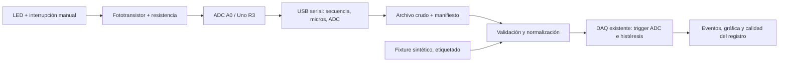

# Banco óptico de MiniNeutron: del protoboard a un módulo soldado

## Estado y objetivo

**Diseño de referencia y software de desarrollo. No construido ni validado físicamente.**
Arduino Uno R3 se usa como referencia porque existe experiencia previa del autor
con esa placa; el inventario disponible y el modelo de fototransistor aún deben
confirmarse. No se asume compatibilidad eléctrica directa con Teensy o con el servo.

El objetivo es detectar interrupciones de luz, conservar sus muestras ADC y
estudiar detección de eventos y errores temporales. Añade una entrada óptica a
la DAQ de MiniNeutron; no reemplaza Geant4 ni simula la respuesta de un detector
real de neutrones. No controla motores ni produce un trigger de precisión para
el chopper del laboratorio.



## Qué se aprende y qué evidencia se puede generar

- Montaje de circuitos, polaridad, alimentación, continuidad y diagnóstico.
- Soldadura electrónica de componentes y conectores en placa perforada.
- Señales analógicas, ADC, umbral, histéresis y registro temporal.
- Distinción entre reloj del dispositivo y llegada de datos al PC.
- Pruebas repetibles, conservación de datos crudos y documentación de límites.

La evidencia física será: fotos de ambas caras, esquema final, BOM real, lectura
de tensiones, archivo crudo, parámetros y comparación protoboard/placa soldada.
La existencia del firmware no demuestra habilidad de soldadura ni montaje real.

## Materiales de referencia

- Arduino Uno **R3** y cable USB. No intercambiar con R4/Teensy sin revisar el diseño.
- Fototransistor NPN compatible con luz del LED y alimentación de 5 V; anotar
  fabricante, referencia, patillaje y límites de su hoja de datos antes de conectar.
- LED visible, resistencia de 1 kohm (valor inicial conservador) y fuente USB de la placa.
- Resistencia de 10 kohm como pull-up del fototransistor (valor inicial a evaluar).
- Protoboard, cables, multímetro y tarjeta opaca para interrumpir la luz.
- Para la segunda etapa: placa perforada, conectores, estaño, cautín, soporte,
  extracción de humos y elementos de sujeción. Osciloscopio si está disponible.

No se exige comprar una referencia concreta antes de conocer los componentes
existentes. Los valores son una propuesta didáctica, no un diseño calificado.

## Circuito propuesto y polaridad

```text
+5 V --- R_LED 1 kohm --- ánodo LED cátodo --- GND
                           luz --> fototransistor

+5 V --- R_PULLUP 10 kohm ---+--- A0 (Uno R3)
                           |
                           C
                     fototransistor NPN
                           E
                           |
                          GND
```

La luz aumenta la conducción y baja el voltaje del colector; una interrupción
lo eleva. Por ello el trigger ascendente representa **bloqueo de luz**, no su
llegada. Confirmar esa polaridad con mediciones. La histéresis de software evita
rearmar hasta que la señal baje del umbral inferior, pero no arregla una señal
sin contraste, una masa desconectada o pérdidas de muestras.

Para dimensionar el LED: `I_LED ≈ (Vcc - Vf) / R_LED`. Por ejemplo, con Vf = 2 V
**supuesto**, 5 V y 1 kohm darían aproximadamente 3 mA; usar Vf y corriente admisible
reales. El pull-up limita corriente y convierte la respuesta óptica en tensión;
modificarlo también cambia sensibilidad y respuesta temporal. No seleccionar
sus valores por una supuesta velocidad del chopper sin medición.

Mantener A0 entre GND y la alimentación de la placa. No conectar líneas de 24 V,
RS-422/RS-485 ni señales del servo a este circuito. La interfaz con el sistema
real será otro diseño, acordado y revisado con el equipo.

## Implementación física, paso a paso

1. Registrar inventario y dibujar patillajes usando las hojas de datos.
2. Con alimentación desconectada, montar el LED con resistencia y el sensor.
3. Comprobar continuidad, polaridad y ausencia de cortocircuito entre 5 V y GND.
4. Alimentar por USB; medir Vcc y A0 con luz/interrupción. Registrar valores.
5. Verificar que hay separación clara entre estados; corregir alineación y luz
   ambiente antes de elegir umbrales. 3 V/2 V son valores del ejemplo sintético,
   no umbrales calibrados para un sensor desconocido.
6. Cargar firmware, capturar datos y comprobar secuencia, intervalos y saturación.
7. Hacer tres series de 20 interrupciones lentas, empezando y terminando con luz.
   Contar de manera independiente y conservar cada serie. Un conteo manual es
   una comprobación funcional, **no una referencia temporal precisa**.
8. Sólo tras funcionar en protoboard, planificar la placa perforada: conectores
   rotulados, masa común, puntos de prueba A0/GND y sujeción de cables.
9. Soldar sin alimentación, con soporte de cautín y extracción de humos;
   revisar uniones y puentes, y repetir continuidad antes de energizar.
10. Repetir las mismas series con la placa soldada y comparar resultados. Registrar
    fallos y cambios sin descartar capturas que contradigan lo esperado.

El movimiento de prueba es manual y lento. No hace falta fabricar discos ni
conectar mecanismos de alta velocidad para demostrar estas competencias.

## Firmware y protocolo

Archivo: `daq/hardware/optical_bench/optical_bench.ino`.
En Arduino IDE seleccionar Uno R3, compilar y cargar. Con Arduino CLI instalado:

```sh
arduino-cli compile --fqbn arduino:avr:uno daq/hardware/optical_bench
arduino-cli upload --fqbn arduino:avr:uno --port /dev/ttyACM0 daq/hardware/optical_bench
```

Esos comandos requieren instalar el core AVR y confirmar el puerto. La compilación
para AVR, carga y prueba de banco están pendientes; un chequeo C++ en host no
las sustituye. El firmware espera `s` para iniciar y `x` para detener.

- Puerto: 115200 baud, 8N1.
- Objetivo de muestreo: 500 Hz, una lectura A0 cada 2000 us.
- Cabecera: `sample,timestamp_us,adc_raw`.
- ADC: enteros de 0 a 1023. Sin trigger en el microcontrolador en esta versión.
- Tiempo: `micros()` inmediatamente antes de `analogRead`, no instante exacto
  de apertura del ADC ni tiempo del puerto USB. El código registra el tiempo
  observado; no fuerza una tasa exacta ni garantiza tiempo real.
- Índice: aumenta también cuando se omiten slots o no cabe una línea en el buffer
  serial. El importador cuenta esos huecos; no inventa muestras intermedias.
- Sesión limitada a 10000 slots (20 s); después hay que enviar `s` otra vez.
  Así el índice tiene como máximo 4 cifras y la línea de datos, 21 bytes:
  10500 bytes/s como cota a 500 Hz, frente a 11520 bytes/s nominales a 115200
  baud en 8N1. Es un presupuesto de enlace, no una garantía de captura sin pérdidas.

## Captura y análisis

Desde la raíz, con el entorno de Python activado:

```sh
python -m pip install -r daq/hardware/requirements.txt
python -m daq.capture_serial --port /dev/ttyACM0 --samples 5000 --output-dir results/optical_capture_001
python -m daq.optical_bench analyze --input results/optical_capture_001/raw_stream.txt --source hardware --output-dir results/optical_analysis_001 --vref 5.0 --trigger 3.0 --rearm 2.0
```

Adaptar puerto, Vref y umbrales a las mediciones. Usar directorios nuevos: los
comandos no sobrescriben corridas. Cerrar el monitor serial antes de capturar.
El capturador espera el reinicio USB, envía `s`, recibe un número finito de
muestras y envía `x`. Si expira el plazo, conserva bytes parciales y registra el
fallo. No hay hardware USB conectado en la validación de software de esta entrega.
Si hay pérdidas puede obtener menos de 10000 registros por sesión: el objetivo
por defecto de 5000 deja margen, sin ocultar huecos de secuencia.

El importador rechaza líneas incompletas, ADC fuera de rango, duplicados, reinicios
de secuencia y tiempos inválidos. Admite rollover de `micros()` sólo cuando la
resta modular da un avance positivo de hasta 1 s; gaps mayores se rechazan para
no confundir reinicios con rollovers. No admite captura continua de varias vueltas
del reloj sin datos. No reinicia sesiones automáticamente.

Salidas: archivo crudo preservado, `waveform.csv`, `detected_events.csv`,
`simulated_pulses.png` (nombre histórico conservado, título genérico), log y
`manifest.json` con procedencia, hashes, parámetros y calidad de adquisición.
`voltage_V = adc_raw × Vref / 1023` es la convención de escala de MiniNeutron;
no es una calibración del ADC ni su función de transferencia física exacta.
Los timestamps se expresan en segundos desde la primera muestra recibida.

El trigger se ejecuta **offline en Python** sobre códigos ADC; no se usa el PC
como controlador en tiempo real. Un evento activo al empezar o terminar la
captura puede estar truncado. Para medir duración completa hay que capturar
baseline antes y después. Una señal permanentemente alta genera un evento
truncado, no prueba una detección correcta.

## Experimento sin hardware

```sh
python -m daq.optical_bench study --output-dir results/optical_study_001
python -m unittest discover -s tests -v
```

Genera seis streams sintéticos de 5000 muestras: tres semillas y dos niveles
de ruido. Cada stream se analiza con tres pares de umbrales (18 configuraciones).
Hay 20 interrupciones rectangulares de 80 ms, separadas 0.5 s; baseline 150 códigos,
nivel alto 850 y ruido gaussiano de sigma 8 o 120 códigos antes de recorte y redondeo.
Los intervalos sintéticos no son perfectamente uniformes: tienen perturbaciones
acotadas y están en una rejilla de 4 us. Esto ejercita el software, no caracteriza
un Uno, sensor o jitter de un reloj real. El modelo omite tiempos de subida,
respuestas espectrales, luz ambiente variable y dinámica del fototransistor.

La comparación asocia cada flanco truth al trigger disponible más cercano dentro
de ±10 ms, una vez por trigger, en orden temporal. Los pulsos están ampliamente
separados. Un trigger por ruido cercano a un flanco puede asociarse: la métrica
es concordancia temporal de este fixture, no prueba de causalidad. Los triggers
no asociados pueden ser ruido, fragmentación o detecciones demasiado tardías;
no deben llamarse todos «ruido». El error temporal sólo se informa para asociados.
Una comparación física necesitará un canal de referencia independiente.

## Criterios propuestos para pasar a placa soldada

- Tres series funcionales de 20 interrupciones contadas, sin diferencias de conteo;
  documentar duración, iluminación, alineación y método de conteo independiente.
- Sin huecos de secuencia ni reinicios durante esas capturas.
- Estados ópticos separados de los umbrales; registrar margen y ruido medido.
- Medir distribución de intervalos; la media de 500 Hz por sí sola no demuestra
  estabilidad temporal. Las muestras en riel se reportan, no se eliminan.
- Tras soldar, repetir protocolo y comparar: cualquier cambio debe investigarse.

Son criterios de aprendizaje propuestos, no especificaciones del chopper. A 500 Hz
el intervalo nominal es 2 ms: no acredita errores de sincronización de microsegundos.
Para otra escala habrá que acordar requisitos y evaluar comparador, captura por
hardware, contador/encoder, temporizador o FPGA. No se elige FPGA por anticipado.

## Fuentes primarias y alcance

- [Arduino Uno R3](https://docs.arduino.cc/hardware/uno-rev3/): placa de referencia.
- [Arduino analogRead](https://docs.arduino.cc/language-reference/en/functions/analog-io/analogRead/)
  y [micros](https://docs.arduino.cc/language-reference/en/functions/time/micros/):
  APIs de adquisición y reloj; precisión a verificar en la placa.
- [Arduino availableForWrite](https://docs.arduino.cc/language-reference/en/functions/communication/serial/availableForWrite/):
  espacio del buffer de transmisión para evitar esperar a que se vacíe.
- [onsemi AN-3005](https://www.onsemi.com/download/application-notes/pdf/an-3005-d.pdf):
  configuración de fototransistor con resistencia de colector. No define el
  componente disponible ni reemplaza su hoja de datos.
- [Vishay, aplicaciones de sensores](https://www.vishay.com/docs/84154/appnotesensors.pdf):
  ejemplos de lectura de fototransistores; no atribuir su rendimiento a este banco.
- [pySerial](https://pyserial.readthedocs.io/en/latest/pyserial_api.html):
  timeout y lectura de bytes; una lectura puede devolver sólo parte de una línea.

## Registro de construcción pendiente

Completar `docs/hardware/build_record_template.md` cuando se realice el montaje.
No publicar fotos, números de serie o información del laboratorio sin autorización.
El circuito propuesto es propio de este banco educativo, no documentación del CCHEN.
